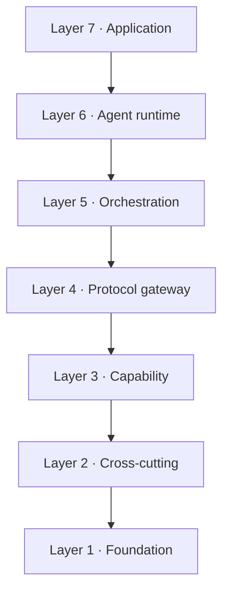
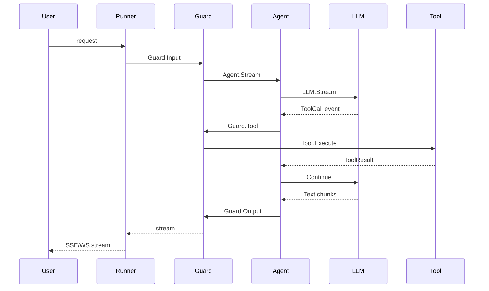
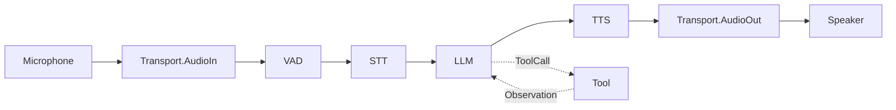
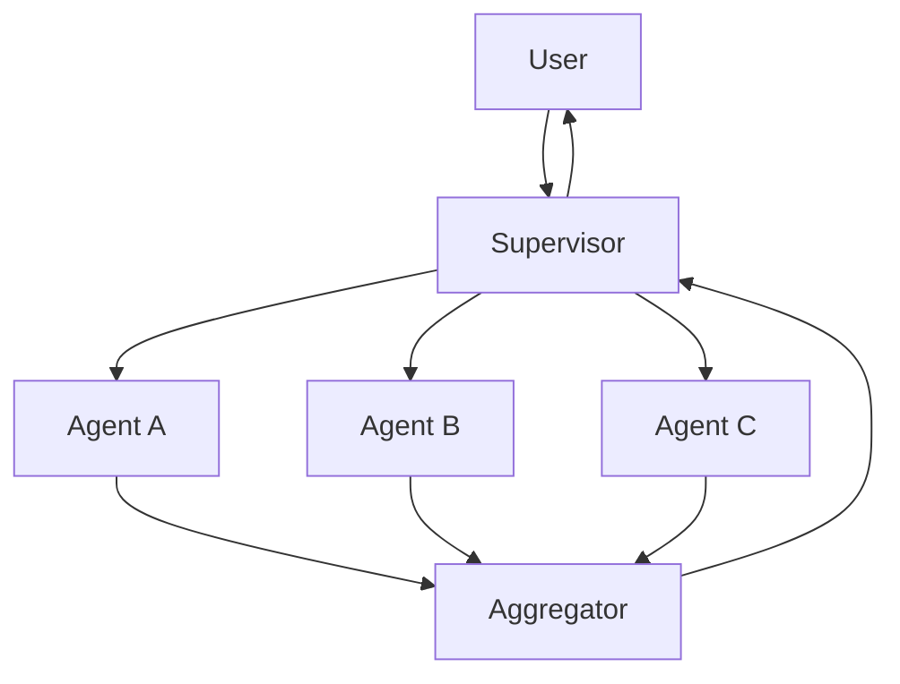

# DOC-01: Architecture Overview — The 7-Layer Model

**Audience:** Framework evaluators, new contributors, architects deciding whether to adopt.
**Prerequisites:** None. This is the root document.
**Related:** [02 — Core Primitives](./02-core-primitives.md), [03 — Extensibility Patterns](./03-extensibility-patterns.md), [18 — Package Dependency Map](./18-package-dependency-map.md).

## Overview

Beluga AI v2 is a Go-native agentic AI framework organised as seven layers. Layer N depends only on layers 1…N−1. Data flows down the stack via typed event streams. There is no hidden global state, no runtime reflection, and no framework magic — every extension point is an explicit interface registered in an explicit registry.

This document is the master map. Read it, and every other architecture doc will tell you where it fits.

## The stack

A text rendering of the stack:

```
┌──────────────────────────────────────────────────────────────────────┐
│  Layer 7 — Application                                                │
│  User code · CLI tools · API servers · LiveKit handlers · K8s CRDs    │
├──────────────────────────────────────────────────────────────────────┤
│  Layer 6 — Agent runtime                                              │
│  Runner → Agent → Executor (Plan → Act → Observe → Replan)            │
│  Persona · Tools · Planner (9 strategies) · Team (3 patterns)         │
├──────────────────────────────────────────────────────────────────────┤
│  Layer 5 — Orchestration                                              │
│  Supervisor · Handoff · Scatter-Gather · Pipeline · Blackboard · Router│
├──────────────────────────────────────────────────────────────────────┤
│  Layer 4 — Protocol gateway                                           │
│  MCP · A2A · REST/SSE · gRPC · WebSocket · Server framework           │
├──────────────────────────────────────────────────────────────────────┤
│  Layer 3 — Capability layer                                           │
│  LLM · Tools · Memory · RAG · Voice · Guard · Prompt · Eval · Cache   │
├──────────────────────────────────────────────────────────────────────┤
│  Layer 2 — Cross-cutting concerns                                     │
│  Resilience · Auth · Audit · Cost · State · Workflow                  │
├──────────────────────────────────────────────────────────────────────┤
│  Layer 1 — Foundation                                                 │
│  core · schema · config · o11y                                        │
└──────────────────────────────────────────────────────────────────────┘
```



Only downward arrows should exist. If you find an upward import, it's a bug; [DOC-18](./18-package-dependency-map.md) lists the known ones and makes the rule explicit.

## What each layer does

### Layer 1 — Foundation

Zero external dependencies beyond the Go stdlib and OpenTelemetry. Contains:

- **`core`** — `Stream[T]`, `Event[T]`, `Runnable`, `core.Error` with `ErrorCode`, context helpers. See [`.guild/wiki/patterns/error-handling.md`](../../.guild/wiki/patterns/error-handling.md).
- **`schema`** — wire types: `Message`, `ContentPart`, `Tool`, `Document`, `Session`.
- **`config`** — generic `Load[T]` (JSON), env overrides, validation, a polling `FileWatcher` for hot-reload.
- **`o11y`** — OTel GenAI conventions (`gen_ai.*` attributes), span wrappers, slog adapters. See [`.guild/wiki/patterns/otel-instrumentation.md`](../../.guild/wiki/patterns/otel-instrumentation.md).

**Rule:** Nothing in Layer 1 imports anything above it.

### Layer 2 — Cross-cutting concerns

Concerns that apply uniformly across the capability layer: circuit breakers, retry, hedging and rate limits (`resilience`), RBAC/ABAC (`auth`), audit logging, cost tracking, agent state, and workflows. They are used around Layer 3 calls as helpers, plugins and middleware; see [DOC-03](./03-extensibility-patterns.md) for the composition model. (Sandboxed code execution lives in `tool/sandbox`.)

### Layer 3 — Capability layer

The heart of the framework. Ten packages, most following the same four extension mechanisms (interface → registry → hooks → middleware):

| Package | What it provides |
|---|---|
| `llm` | Chat/completion models, routing, structured output, context management |
| `tool` | Native tools, MCP client, registry, middleware, hooks |
| `memory` | 3-tier memory (working/recall/archival) + graph store |
| `rag` | Ingestion, embedding, hybrid retrieval (BM25+vector+RRF), reranking |
| `voice` | Frame-based STT/TTS/S2S pipelines |
| `guard` | 3-stage safety pipeline (Input → Output → Tool) |
| `prompt` | Versioning, cache-optimised prompt building |
| `eval` | Metrics and evaluation runners |
| `cache` | Exact and semantic caches |
| `hitl` | Human-in-the-loop approval gates |

Every capability package is **pluggable**: if you don't like the default LLM router, implement the interface and `Register()` your own.

### Layer 4 — Protocol gateway

Where Beluga meets the outside world. Each protocol is its own server that takes an agent (or tools); the `Runner` does not mount them itself:

- **MCP** — `protocol/mcp`: server for tool/resource/prompt exposure and a client, Streamable HTTP.
- **A2A** — `protocol/a2a`: Agent-to-Agent over HTTP, with `AgentCard` discovery at `/.well-known/agent.json`.
- **REST/SSE** — `protocol/rest` and `server.NewAgentHandler`: plain HTTP plus Server-Sent Events for streaming.
- **AG-UI** — `protocol/agui`.
- **Framework adapters** — `server/adapters/*` for Gin, Fiber, Echo, Chi, gRPC, Connect-Go and Huma.
- **WebSocket** — `voice/transport` for audio.

See [DOC-12](./12-protocol-layer.md).

### Layer 5 — Orchestration

Built-in patterns for multi-agent coordination live in `orchestration` (as `core.Runnable` values; `Pipeline` and `HandoffOrchestrator` implement its `OrchestrationPattern` interface) and in `runtime` (`PipelinePattern`, `SupervisorPattern`, `ScatterGatherPattern` for `runtime.Team`):

- **Supervisor** — central coordinator delegates to specialists.
- **Handoff** — agent A transfers control to agent B via a tool.
- **Scatter-Gather** — fan out to N agents in parallel, aggregate.
- **Pipeline** — linear sequence, each stage consumes the prior stage's output.
- **Blackboard** — agents communicate only through shared state.
- **Router** — a classifier picks the agent for each input.

Teams **are** agents (`runtime.Team` implements `agent.Agent`), so a team-of-teams is just recursive composition. See [DOC-07](./07-orchestration-patterns.md).

### Layer 6 — Agent runtime

The core execution engine:

- **`Runner`** (`runtime`) — deployment boundary. Owns sessions, plugins, a worker pool and graceful shutdown. See [DOC-08](./08-runner-and-lifecycle.md).
- **`Agent`** — persona + tools + planner + memory + hooks. See [DOC-05](./05-agent-anatomy.md).
- **`Executor`** — runs the Plan → Act → Observe → Replan loop, emits events. See [DOC-04](./04-data-flow.md).
- **`Planner`** — decides the next action. Registered strategies: react, reflexion, self-discover, tree-of-thought, graph-of-thought, lats, mindmap, moa, codeact. See [DOC-06](./06-reasoning-strategies.md).
- **`Team`** (`runtime.Team`) — composes multiple agents via an orchestration pattern.

Hooks fire at every lifecycle point. Handoffs appear as auto-generated `transfer_to_{name}` tools.

### Layer 7 — Application

Your code. A CLI. An HTTP server. A LiveKit voice handler. A Kubernetes controller loading `Agent` CRDs. This layer *uses* Beluga; Beluga never reaches back up.

The framework ships one reference Layer 7 application: the `beluga` CLI at [`cmd/beluga/`](../../cmd/beluga/). It is a cobra-based command-line tool with nine subcommands (`version`, `providers`, `init`, `new`, `run`, `dev`, `test`, `eval`, `deploy`), installable via `go install github.com/lookatitude/beluga-ai/v2/cmd/beluga@latest`. Release binaries for Linux, macOS, and Windows are attached to each GitHub release with a sha256 `checksums.txt`. The CLI is the canonical example of how to build a Layer 7 application: it composes Layer 3 providers (llm, rag/embedding, rag/vectorstore, memory) via blank imports in [`cmd/beluga/providers/providers.go`](../../cmd/beluga/providers/providers.go) and reads the framework version via the leaf package at [`cmd/beluga/internal/version`](../../cmd/beluga/internal/version/version.go). See [DOC-Reference: CLI](../reference/cli.md) for full command documentation.

### Canonical consumer shape

Every Layer 7 consumer of Beluga follows the same minimal shape. The **mandatory elements** are: `package main` at the top; exactly one LLM provider registered via a blank import (`_ "github.com/lookatitude/beluga-ai/v2/llm/providers/<name>"`) so its `init()` side-effect populates the `llm` registry; a call to `llm.New(name, config.ProviderConfig{Provider, APIKey, Model})` that returns a wired instance; and an agent constructed via `agent.New(id, agent.WithLLM(model), agent.WithPersona(agent.Persona{...}))`. Execution enters the agent through either `a.Invoke(ctx, input)` for one-shot request/response or `a.Stream(ctx, input)` for incremental event-stream consumption. These five elements are always present — any Beluga application that compiles and runs has them.

The **optional elements** layer on top without changing that shape. `agent.WithTools([]tool.Tool{...})` registers tools for dispatch inside the Plan → Act → Observe loop; `agent.WithPlannerName("reflexion")` (or any other name from [DOC-06](./06-reasoning-strategies.md)) overrides the default `react` strategy; `agent.ApplyMiddleware(a, agent.WithTracing())` emits OTel GenAI spans at the agent boundary (see [DOC-14](./14-observability.md)); and an `o11y.BootstrapFromEnv(ctx, serviceName)` call at startup configures trace export from `OTEL_*` environment variables so the same binary runs locally and in production without code changes.

The **import discipline** is what keeps middleware, hooks, and metrics attached correctly: providers always land via `_ "…/providers/<name>"` blank imports, rather than by constructing a provider's concrete type directly, so the application depends only on `llm.ChatModel` and the provider name can come from configuration. `llm.New` does not add middleware; wrap the result with `llm.ApplyMiddleware` yourself. See the [First Agent guide](../guides/first-agent.md) for a fully worked consumer; the `beluga init` CLI generates a scaffolded project with exactly this shape so new users can copy, run, and modify without writing boilerplate.

## How data flows

Three canonical flows:

### Text chat



### Voice agent



See [DOC-11](./11-voice-pipeline.md).

### Multi-agent scatter-gather



See [DOC-07](./07-orchestration-patterns.md).

## The four design principles

### 1. Streaming first

`Invoke()` is the convenience form; `Stream()` is the primary path and returns a type-safe `iter.Seq2` (for example `iter.Seq2[agent.Event, error]`; `core.Stream[T]` is the generic `iter.Seq2[core.Event[T], error]`). See [`.guild/wiki/patterns/streaming.md`](../../.guild/wiki/patterns/streaming.md). Channels never appear in public APIs.

**Why:** streaming matches how LLMs actually emit tokens, avoids goroutine leaks that plague channel-based designs, and composes cleanly via `core.MapStream`, `core.MergeStreams` and `core.FanOut`.

### 2. Composition over inheritance

`agent.BaseAgent`, `workflow.SequentialAgent`, `runtime.Team` and your own agent types each implement the small `agent.Agent` interface directly. There is no class hierarchy and no base type to inherit from.

**Why:** Go's embedding is explicit, free of the surprises of virtual dispatch, and lets `Runnable` be a first-class unit of composition ([DOC-02](./02-core-primitives.md)).

### 3. Minimal core, rich ecosystem

`core/` and `schema/` have **zero** external dependencies beyond the Go stdlib and OpenTelemetry. Providers live in `*/providers/` subdirectories and pull their own SDKs. You can import `core` and build a toy agent without touching a single cloud SDK.

**Why:** keeps the critical path auditable, makes dependency updates targeted (a breaking change in the OpenAI SDK never destabilises `memory/`), and enables embedded/edge use cases.

### 4. Production-ready by default

Every extensible package ships with `WithTracing()` middleware that emits OTel GenAI spans at package boundaries ([DOC-14](./14-observability.md)). Circuit breakers, retry, hedging and rate limiting are generic helpers in `resilience/`, and `llm` adds rate-limit and fallback middleware ([DOC-15](./15-resilience.md)). The `workflow/` package defines a durable-execution interface with an in-process executor and a Temporal executor that is not yet complete ([DOC-16](./16-durable-workflows.md)).

**Why:** observability and resilience are default concerns for any agent running in a multi-tenant or long-running context. Requiring users to bolt these on after the fact produces inconsistent coverage. Shipping them as opt-in middleware on every interface keeps the path from prototype to production a configuration change, not an architectural one.

## The universal package shape

Every pluggable package looks like this:

```
<package>/
├── <interface>.go      # The interface — 1 to 4 methods
├── registry.go         # Register / New / List
├── hooks.go            # Optional func fields, ComposeHooks
├── middleware.go       # type Middleware func(T) T, ApplyMiddleware
├── errors.go           # Package-specific error codes
├── <package>_test.go   # Table-driven tests
└── providers/          # Concrete implementations
    └── <provider>/
        └── <provider>.go  # Registers in init()
```

`llm/`, `memory/`, `rag/vectorstore/`, `rag/embedding/`, `rag/retriever/`, `voice/*`, `guard/`, `workflow/`, `server/`, `cache/`, `auth/`, `state/` follow this template (`tool/` uses an instance registry instead of `Register`/`New`). Learn it once, apply it everywhere. See [DOC-03](./03-extensibility-patterns.md) for the full rationale.

## Where to go next

- You're evaluating the framework → [DOC-02](./02-core-primitives.md) then [DOC-05](./05-agent-anatomy.md).
- You're building an agent → [First Agent guide](../guides/first-agent.md).
- You're extending the framework → [DOC-03](./03-extensibility-patterns.md) then [Provider Template](../patterns/provider-template.md).
- You're operating the framework → [DOC-14](./14-observability.md) then [DOC-17](./17-deployment-modes.md).

## Common mistakes

- **Importing upward.** If your code in `core/` needs to know about `llm/`, restructure — the dependency belongs in `llm/` as a consumer of `core/`, not the reverse.
- **Treating `Invoke()` as the primary API.** `Invoke()` is a helper; the real contract is `Stream()`.
- **Bypassing the registry.** Prefer `llm.New("openai", cfg)` over a provider's concrete constructor, so the provider is chosen by configuration and your code depends only on `llm.ChatModel`.

## Related reading

- [02 — Core Primitives](./02-core-primitives.md) — `Stream`, `Event`, `Runnable`, context helpers.
- [03 — Extensibility Patterns](./03-extensibility-patterns.md) — the 4 mechanisms.
- [04 — Data Flow](./04-data-flow.md) — complete request lifecycle.
- [18 — Package Dependency Map](./18-package-dependency-map.md) — enforces the layering rule.
- [`.guild/wiki/architecture/invariants.md`](../../.guild/wiki/architecture/invariants.md) — the ten invariants with source references.
