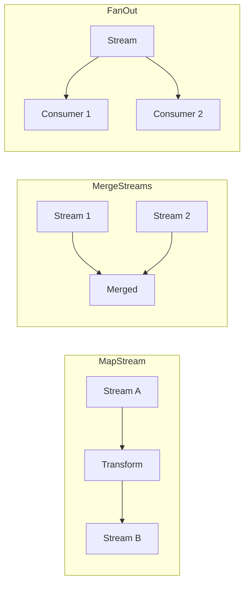
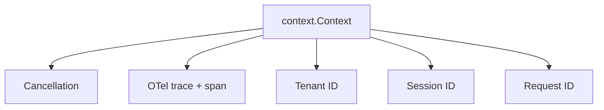

# DOC-02: Core Primitives

**Audience:** Everyone who writes code against Beluga.
**Prerequisites:** None (but [01 — Overview](./01-overview.md) gives you the context).
**Related:** [03 — Extensibility Patterns](./03-extensibility-patterns.md), [04 — Data Flow](./04-data-flow.md), [`.guild/wiki/patterns/streaming.md`](../../.guild/wiki/patterns/streaming.md), [`.guild/wiki/patterns/error-handling.md`](../../.guild/wiki/patterns/error-handling.md).

## Overview

Four primitives underpin every package in Beluga: `Event[T]`, `Stream[T]`, `Runnable`, and the context helpers (`WithTenant`, `WithSessionID`, etc.). Understand these four and you understand the framework's contract.

## Event[T] — the unit of data flow

Every emission from a streaming component is an `Event`. It carries a payload, optional error, and metadata.

```go
// core/stream.go (excerpt)
type EventType string

const (
    EventData       EventType = "data"        // payload chunk
    EventToolCall   EventType = "tool_call"   // LLM asked to call a tool
    EventToolResult EventType = "tool_result" // tool returned
    EventHandoff    EventType = "handoff"     // agent-to-agent transfer
    EventDone       EventType = "done"        // stream terminated normally
    EventError      EventType = "error"       // error within the stream
)

type Event[T any] struct {
    Type    EventType
    Payload T
    Err     error
    Meta    map[string]any
}
```

### Why one type for the whole stream

You could have separate stream types (`MessageStream`, `ErrorStream`, `ToolCallStream`) and tag-dispatch at the call site, but that forces every consumer to build N parallel goroutines. `Event[T]` keeps it linear: one `for ev, err := range stream` covers all cases.

### Why `Meta map[string]any`

The metadata map carries per-event information that isn't part of the payload: trace/span IDs, provider-specific annotations, timing, cost hints. `any` is acceptable here because `Meta` is observational — nothing in the critical path depends on its contents. The core type system stays strict (`Event[T]` is generic) while the metadata stays flexible.

## Stream[T] — the transport

`Stream[T]` is a type alias for an `iter.Seq2` of events, so range-over-func works directly:

```go
// core/stream.go (excerpt)
type Stream[T any] = iter.Seq2[Event[T], error]
```

Most public streaming APIs return a plain `iter.Seq2` with a concrete element type: `llm.ChatModel.Stream` yields `schema.StreamChunk`, `agent.Agent.Stream` yields `agent.Event`, `core.Runnable.Stream` yields `any`.

### Consumer pattern

```go
for ev, err := range stream {
    if err != nil {
        return err
    }
    // handle ev.Payload
}
```

The `yield` protocol guarantees backpressure: if the consumer breaks, `yield` returns `false` and the producer must stop and clean up. No goroutine leaks.

### Stream operations

`core` provides helpers over `Stream[T]`:



- **`MapStream(s, fn)`** — apply a transformation to every event. **`FilterStream(s, keep)`** drops events.
- **`MergeStreams(ctx, s...)`** — fan N streams in to one, in arrival order.
- **`FanOut(ctx, s, n)`** — broadcast one stream to `n` independent consumers.
- **`NewBufferedStream(ctx, s, size)`** — decouple producer and consumer speed; **`CollectStream(s)`** drains to a slice.

The context-taking helpers stop when the context is cancelled.

### Why `iter.Seq2` over channels

| Channels | `iter.Seq2` |
|---|---|
| Leak goroutines if the consumer returns early | `yield → false` propagates cancellation eagerly |
| Cannot compose without extra goroutines per stage | Composition is a single function call |
| No generic form until Go 1.21 workarounds | First-class generic since Go 1.23 |
| `select` required for multi-stream coordination | Natural `for … range` syntax |

Beluga requires Go 1.26+ (the `go` directive in `go.mod`); `iter.Seq2` itself arrived in Go 1.23. Channels still exist inside packages as synchronisation primitives, but **they do not cross public API boundaries.**

### Error semantics

The second value of the pair is the stream error: a producer yields at most one non-nil error and then stops, so consumers return or break on it. Recoverable, in-band problems (for example a failed tool call the planner can react to) are carried as events instead, such as an `EventError` event or an observation with an error.

## Runnable — the composable unit

Every component that participates in a pipeline implements `Runnable`:

```go
// core/runnable.go (excerpt)
type Runnable interface {
    Invoke(ctx context.Context, input any, opts ...Option) (any, error)
    Stream(ctx context.Context, input any, opts ...Option) iter.Seq2[any, error]
}
```

### Why `any` at the base level

Type-safe interfaces live at the capability layer: `llm.ChatModel`, `retriever.Retriever`, `tool.Tool` and `agent.Agent` have concrete input and output types and do not implement `Runnable` themselves. `Runnable` is the untyped unit for generic composition: `core.Pipe`, `core.Parallel`, `orchestration.Chain`, `orchestration.ScatterGather` and orchestration middleware all work on it.

### Runnable ⇒ composable

```go
// core.Pipe(a, b Runnable) Runnable: a's Invoke output feeds b.
chain := core.Pipe(retrieveStep, answerStep) // both are core.Runnable
for out, err := range chain.Stream(ctx, userQuery) {
    if err != nil {
        return err
    }
    fmt.Println(out)
}

// core.Parallel(rs ...Runnable) Runnable: same input to each, results as []any.
both, err := core.Parallel(stepA, stepB).Invoke(ctx, userQuery)
```

`orchestration.Chain(steps ...core.Runnable)` chains more than two steps.

### `Invoke` vs `Stream`

`Invoke` is the synchronous convenience form. For agents, `BaseAgent.Invoke` runs the same loop as `Stream` and returns the collected text.

**Rule:** never implement `Invoke` without implementing `Stream`. `Stream` is the contract.

## Context — the invisible argument

`context.Context` is the first parameter of every public function and it carries:



### Cancellation

If the caller aborts, every downstream call — the LLM request, the vector store query, the tool invocation — sees `ctx.Done()` fire and exits cleanly. Every producer respects this.

### OTel trace + span

OTel's `tracer.Start(ctx, "llm.generate")` returns a new context with a child span attached. Downstream code reads the span from the context; `SpanFromContext(ctx)` gives you the current span without manual threading.

### Tenant / session / request ID

Multi-tenancy and per-session state are carried via `context.Context` helpers:

```go
// core/tenant.go and core/context.go
ctx = core.WithTenant(ctx, "acme")
ctx = core.WithSessionID(ctx, sessionID)
ctx = core.WithRequestID(ctx, requestID)

// downstream:
tenant := core.GetTenant(ctx) // core.TenantID("acme")
```

Agent credentials travel the same way through `auth/credential.WithCredential`.

These helpers use typed context keys (an unexported struct-typed constant) to avoid collisions with other packages.

**Never store `ctx` in a struct field.** Pass it per call. Contexts represent a request-scoped lifetime; stashing them in a struct breaks cancellation and tenant isolation.

## Why these four and not more

Beluga's core primitives are deliberately small. Adding a fifth (a `Message`, a `Document`, a `Tool`) is easy — and every capability package does — but the *foundation* stays lean. The four primitives described here are what every other layer composes against.

If you can read a function signature and answer "what `Stream[T]` does it return, what `Event` type carries its payload, what does it do with the `context.Context`?", you have enough to reason about it without reading the source.

## Common mistakes

- **Storing `ctx` in a struct.** Breaks cancellation. Pass it per call.
- **Implementing `Invoke` without `Stream`.** Middleware attaches to `Stream`; consumers that use `Invoke` get the wrong behaviour.
- **Using channels in a public return type.** Return an `iter.Seq2`. Channels live *inside* your implementation if you need them; they don't cross the API boundary.
- **Ignoring `yield → false`.** Producers must check the return of `yield` and stop the pipeline. Otherwise you're leaking work.

## Related reading

- [03 — Extensibility Patterns](./03-extensibility-patterns.md) — how middleware and hooks layer on top of `Runnable`.
- [04 — Data Flow](./04-data-flow.md) — `Event` and `Stream` across a real request.
- [`patterns/streaming-iter-seq2.md`](../patterns/streaming-iter-seq2.md) — the pattern doc with extended examples.
- [`patterns/error-handling.md`](../patterns/error-handling.md) — `core.Error` + `ErrorCode` contract.
- [`patterns/context-propagation.md`](../patterns/context-propagation.md) — tenant / session / auth details.
- [`.guild/wiki/patterns/streaming.md`](../../.guild/wiki/patterns/streaming.md) — canonical code references.
