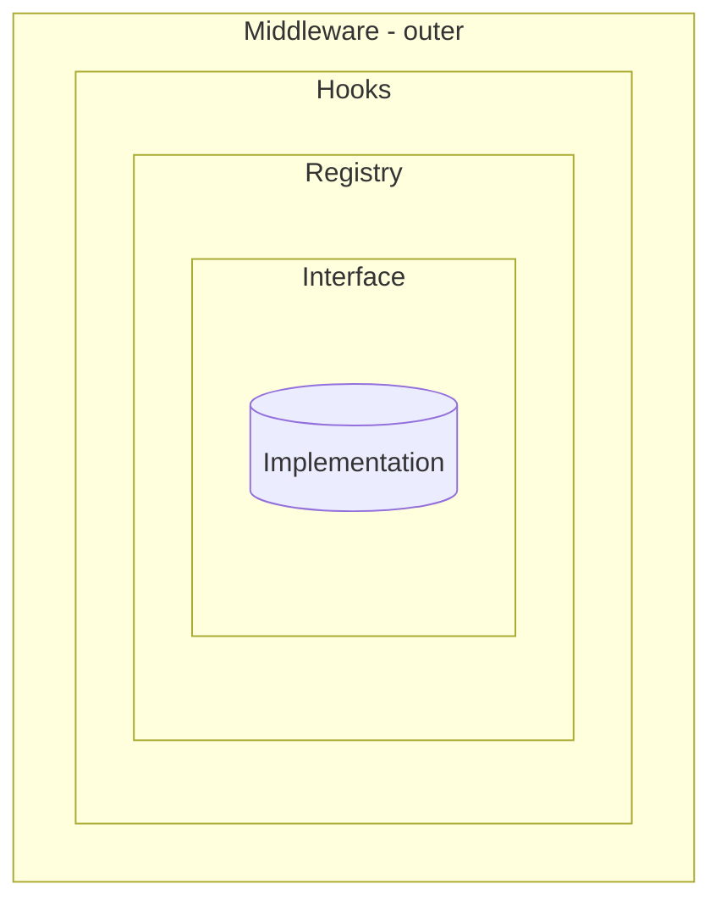
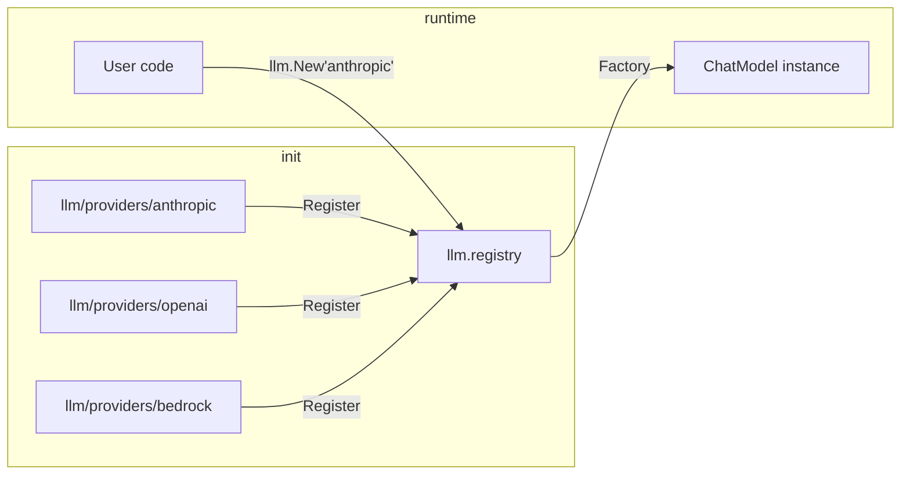
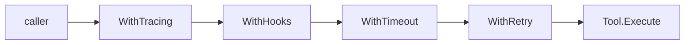
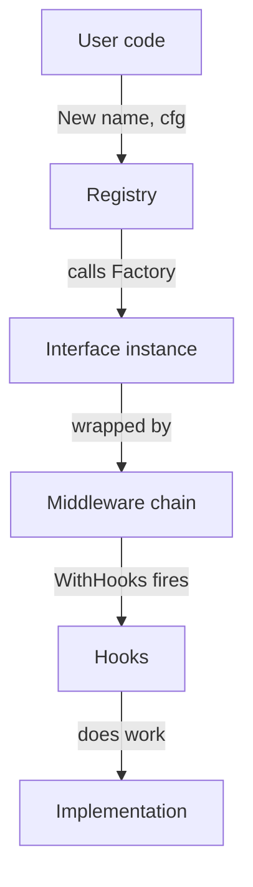

# DOC-03: Extensibility Patterns — The Four Mechanisms

**Audience:** Anyone extending Beluga. If you're implementing a provider, writing middleware, or adding a hook, start here.
**Prerequisites:** [02 — Core Primitives](./02-core-primitives.md).
**Related:** [05 — Agent Anatomy](./05-agent-anatomy.md), [Registry + Factory](../patterns/registry-factory.md), [Middleware Chain](../patterns/middleware-chain.md), [Hooks Lifecycle](../patterns/hooks-lifecycle.md).

## Overview

Every extensible package in Beluga uses the same four mechanisms:

1. **Interface** — the compile-time contract (≤4 methods).
2. **Registry** — runtime discovery. `Register` / `New` / `List`.
3. **Hooks** — interception at lifecycle points. Optional, nil-safe, composable.
4. **Middleware** — cross-cutting wrapping. `func(T) T`, applied outside-in.

Learn these four. They apply to `llm`, `tool`, `memory`, `rag/embedding`, `rag/vectorstore`, `rag/retriever`, `voice/*`, `guard`, `workflow`, `server`, `cache`, `auth`, and `state`. One exception: `tool` has an instance registry (`tool.NewRegistry`) instead of a package-level `Register`/`New`/`List` (see Ring 2). Once you understand the shape, every package is learnable in minutes.

## The four concentric rings



- **Interface** is the inner contract: what methods exist.
- **Registry** turns names into instances at runtime.
- **Hooks** fire at specific lifecycle points.
- **Middleware** wraps the whole call from the outside.

## Ring 1 — Interface

Small interfaces (≤4 methods) composed as needed. Example from `tool/tool.go`:

```go
type Tool interface {
    Name() string
    Description() string
    InputSchema() map[string]any
    Execute(ctx context.Context, input map[string]any) (*Result, error)
}
```

Four methods. No more. Larger capability surfaces compose via embedding. From `agent/agent.go`:

```go
type Agent interface {
    AgentMetadata // ID, Persona, Tools, Children
    AgentExecutor // Invoke, Stream
}
```

### Why ≤4 methods

- Smaller interfaces are easier to implement, which encourages third-party providers.
- Smaller interfaces are easier to mock in tests.
- Bigger capability is expressed via interface *composition*, not a God interface.

Every implementation includes a compile-time assertion:

```go
var _ llm.ChatModel = (*Model)(nil)
```

## Ring 2 — Registry

A registry lets the framework discover implementations at runtime without import cycles.

Canonical example (from `llm/registry.go`):

```go
// llm/registry.go
type Factory func(cfg config.ProviderConfig) (ChatModel, error)

var (
    registryMu sync.RWMutex
    registry   = make(map[string]Factory)
)

// Register is called from provider init() functions. A duplicate name
// overwrites the previous factory.
func Register(name string, f Factory) {
    registryMu.Lock()
    defer registryMu.Unlock()
    registry[name] = f
}

func New(name string, cfg config.ProviderConfig) (ChatModel, error) {
    registryMu.RLock()
    f, ok := registry[name]
    registryMu.RUnlock()
    if !ok {
        return nil, core.Errorf(core.ErrNotFound, "llm: unknown provider %q (registered: %v)", name, List())
    }
    return f(cfg)
}

func List() []string { /* sorted names */ }
```

Providers register themselves in `init()`:

```go
// llm/providers/anthropic/anthropic.go
func init() {
    llm.Register("anthropic", func(cfg config.ProviderConfig) (llm.ChatModel, error) {
        return New(cfg)
    })
}
```

Not every package has a registry. `tool` has an instance registry (`tool.NewRegistry()` with `Add`/`Get`/`List`) rather than a package-level `Register`/`New`, because tools are values your code constructs, not providers chosen by name.



### Why this, not config files

Before `init()`-based registration, every framework had a YAML or TOML "providers list" that shipped alongside the library and had to be updated by hand. Go's `init()` + import graph lets registration happen transparently: you import `_ "github.com/lookatitude/beluga-ai/v2/llm/providers/anthropic"` and the provider is available. No config, no runtime errors from typos in names.

See [Provider Registration pattern](../patterns/registry-factory.md) and [`.guild/wiki/patterns/provider-registration.md`](../../.guild/wiki/patterns/provider-registration.md).

## Ring 3 — Hooks

Hooks are optional function fields on a struct. `nil` means "skip this hook". `ComposeHooks(h1, h2, h3)` combines multiple hook sets into one that invokes each in order.

Canonical example (from `tool/hooks.go`):

```go
type Hooks struct {
    BeforeExecute func(ctx context.Context, toolName string, input map[string]any) error
    AfterExecute  func(ctx context.Context, toolName string, result *Result, err error)
    OnError       func(ctx context.Context, toolName string, err error) error
}

func ComposeHooks(hooks ...Hooks) Hooks {
    h := append([]Hooks{}, hooks...)
    return Hooks{
        BeforeExecute: /* compose BeforeExecute hooks in order; stop on first error */,
        AfterExecute:  /* compose AfterExecute hooks in order unconditionally */,
        OnError:       /* compose OnError hooks in order; first non-nil return wins */,
    }
}
```

### When to use hooks

Hooks intercept **specific lifecycle points**:

- `BeforeExecute` — before the operation begins. Returning an error aborts execution.
- `AfterExecute` — after the operation completes (success or failure). Receives the result and any error.
- `OnError` — when the operation fails. Can suppress or replace the error.

They are fine-grained. If you need to record the exact moment a planner chose a specific tool, use a hook.

### Hooks vs middleware

| Question | Answer |
|---|---|
| Is this cross-cutting (retry, logging, rate-limit, guardrails)? | **Middleware.** |
| Is this lifecycle-specific (before plan, after tool call)? | **Hooks.** |
| Is this discovery/instantiation? | **Registry.** |
| Is this the contract itself? | **Interface.** |

A rule of thumb: middleware *wraps the whole call*; hooks *fire at specific moments inside the call*.

## Ring 4 — Middleware

Middleware is a function `func(T) T` that wraps an implementation and returns a new one with the same interface but augmented behaviour.

Canonical example (from `tool/middleware.go`):

```go
type Middleware func(Tool) Tool

// ApplyMiddleware applies mws in reverse order, so the first middleware in
// the list is the outermost wrapper.
func ApplyMiddleware(t Tool, mws ...Middleware) Tool {
    for i := len(mws) - 1; i >= 0; i-- {
        t = mws[i](t)
    }
    return t
}
```

Concrete middleware (retry):

```go
func WithRetry(maxAttempts int) Middleware {
    return func(t Tool) Tool {
        return &retryTool{tool: t, maxAttempts: maxAttempts}
    }
}

func (r *retryTool) Execute(ctx context.Context, input map[string]any) (*Result, error) {
    var lastErr error
    for attempt := 0; attempt < r.maxAttempts; attempt++ {
        result, err := r.tool.Execute(ctx, input)
        if err == nil {
            return result, nil
        }
        lastErr = err
        if !core.IsRetryable(err) {
            return nil, err
        }
        if ctx.Err() != nil {
            return nil, ctx.Err()
        }
    }
    return nil, core.Errorf(core.ErrToolFailed, "tool %s failed after %d attempts: %w", r.tool.Name(), r.maxAttempts, lastErr)
}
```

### Application order: outside-in



Call `tool.ApplyMiddleware(t, tool.WithTracing(), tool.WithHooks(h), tool.WithTimeout(d), tool.WithRetry(3))` and the first argument wraps the outside. Read left to right: tracing wraps hooks wraps timeout wraps retry wraps the tool. Every package's `ApplyMiddleware` uses this order.

### Why `func(T) T`

It's the simplest possible signature. No factory interfaces, no builders, no dependency injection frameworks. Just "give me a thing, get back a wrapped thing". It composes trivially (composition is function application) and it's obvious what order things happen in.

See [Middleware Chain pattern](../patterns/middleware-chain.md).

### `WithTracing()` — the canonical framework-wide middleware

One Ring 4 middleware is now provided by every extensible package: `WithTracing()`. It wraps the package interface with OTel GenAI spans named `<pkg>.<method>` using the typed `o11y.Attr*` constants. Seventeen packages (`agent`, `auth`, `hitl`, `llm`, `llm/routing`, `memory`, `orchestration`, `prompt`, `rag/embedding`, `rag/retriever`, `rag/splitter`, `rag/vectorstore`, `server`, `state`, `tool`, `voice/s2s`, `workflow`) all follow the same template rooted in [`memory/tracing.go`](../../memory/tracing.go). Adding `WithTracing()` to a new extensible package is mandatory, not optional. See [DOC-14 — Observability](./14-observability.md) for the template, span-naming rules, and opt-in pattern.

## How the four rings compose



1. **Interface** defines what an extension must implement.
2. **Registry** is how the user's code finds that extension at runtime.
3. **Hooks** fire at lifecycle points inside the wrapped call. In `llm` and `tool` they are installed by the `WithHooks` middleware; `agent` takes them as an option (`agent.WithHooks`).
4. **Middleware** wraps the instance before handing it to the caller.

A complete wire-up looks like this:

```go
// import the provider for its init() side effect
import _ "github.com/lookatitude/beluga-ai/v2/llm/providers/anthropic"

func buildModel(auditHooks, costHooks llm.Hooks) (llm.ChatModel, error) {
    // Ring 2: registry lookup.
    base, err := llm.New("anthropic", config.ProviderConfig{
        Provider: "anthropic",
        APIKey:   os.Getenv("ANTHROPIC_API_KEY"),
        Model:    "claude-sonnet-4-5",
    })
    if err != nil {
        return nil, err
    }

    // Ring 4: middleware. The first argument is the outermost wrapper.
    // Ring 3: hooks are installed through the WithHooks middleware.
    return llm.ApplyMiddleware(base,
        llm.WithTracing(),
        llm.WithLogging(slog.Default()),
        llm.WithProviderLimits(llm.ProviderLimits{RPM: 60, MaxConcurrent: 4}),
        llm.WithHooks(llm.ComposeHooks(auditHooks, costHooks)),
    ), nil
}
```

Retry, circuit breaking and hedging live in `resilience/` as generic helpers that wrap any call, rather than as `llm` middleware:

```go
breaker := resilience.NewCircuitBreaker(5, 30*time.Second)
resp, err := resilience.Retry(ctx, resilience.DefaultRetryPolicy(),
    func(ctx context.Context) (*schema.AIMessage, error) {
        out, err := breaker.Execute(ctx, func(ctx context.Context) (any, error) {
            return model.Generate(ctx, msgs)
        })
        if err != nil {
            return nil, err
        }
        return out.(*schema.AIMessage), nil
    })
```

Guards are not an `llm` middleware either: run a `guard.Pipeline` (`ValidateInput`, `ValidateOutput`, `ValidateTool`) around the call, for example from an `llm.Hooks.BeforeGenerate` hook or a `tool.Hooks.BeforeExecute` hook.

## Common mistakes

- **Using middleware for lifecycle interception.** If you need to fire at a specific moment ("when the planner chooses a tool"), use a hook. Middleware sees only the outer call.
- **Using hooks for cross-cutting concerns.** Retry, rate limit, logging — all apply uniformly to every call, so they're middleware. Adding retry logic to a `BeforeExecute` hook fights the design.
- **Registering outside `init()`.** Registries are meant to be filled at startup. Registering later works (the map is mutex-guarded), but a later `Register` with the same name silently replaces the earlier factory, which is hard to debug.
- **Non-nil-safe hooks.** Always check `if h.BeforeExecute != nil` before invoking. `ComposeHooks` does this for you; hand-rolled code often forgets.
- **Forgetting the compile-time check.** `var _ Interface = (*Impl)(nil)` catches interface-drift at compile time. Add it to every implementation.

## Related reading

- [`patterns/registry-factory.md`](../patterns/registry-factory.md) — the registry pattern with a full example.
- [`patterns/middleware-chain.md`](../patterns/middleware-chain.md) — composition, ordering, and edge cases.
- [`patterns/hooks-lifecycle.md`](../patterns/hooks-lifecycle.md) — nil-safety and when to use hooks.
- [`patterns/provider-template.md`](../patterns/provider-template.md) — building a new provider end-to-end.
- [`.guild/wiki/patterns/provider-registration.md`](../../.guild/wiki/patterns/provider-registration.md), [`middleware.md`](../../.guild/wiki/patterns/middleware.md), [`hooks.md`](../../.guild/wiki/patterns/hooks.md) — canonical code pointers.
