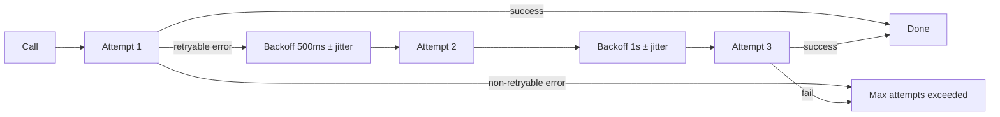
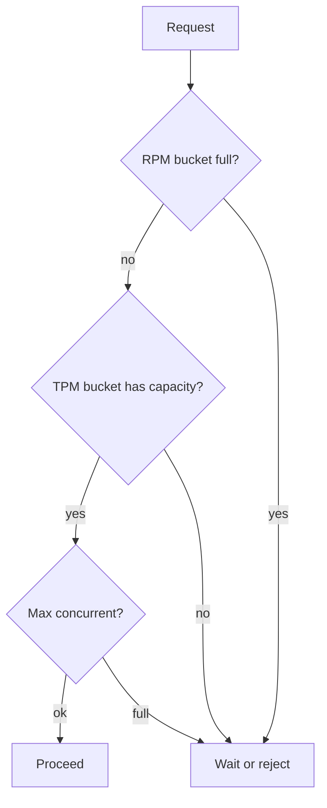
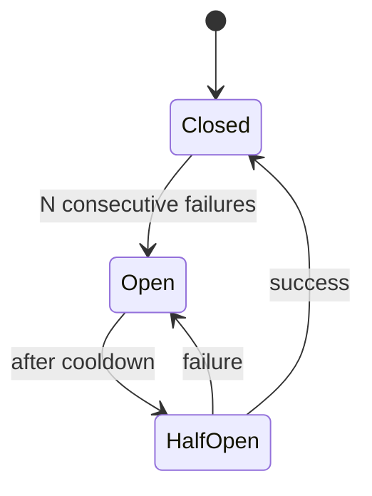
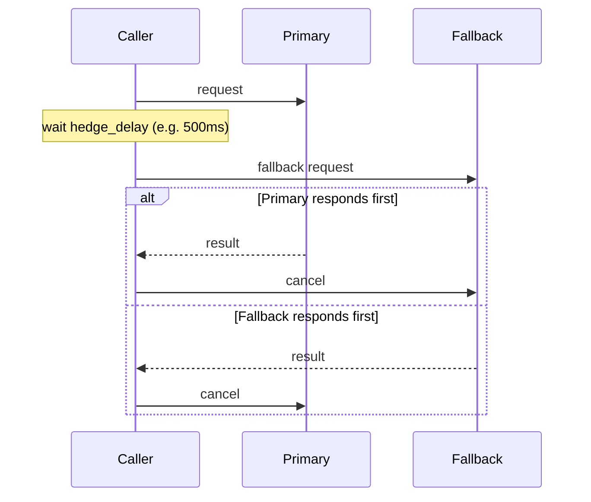

# DOC-15: Resilience Patterns

**Audience:** Anyone running Beluga against real LLM providers or unreliable tools.
**Prerequisites:** [03 — Extensibility Patterns](./03-extensibility-patterns.md).
**Related:** [14 — Observability](./14-observability.md), [`patterns/middleware-chain.md`](../patterns/middleware-chain.md).

## Overview

LLM providers rate limit. Networks fail. Tools time out. Beluga ships four resilience primitives in `resilience/`: **retry** (`Retry`), **rate limit** (`RateLimiter`), **circuit breaker** (`CircuitBreaker`) and **hedged requests** (`Hedge`). They are generic helpers that wrap any call, not package middleware. Separately, `llm` ships `WithProviderLimits` and `WithFallback` middleware, and `tool` ships `WithTimeout` and `WithRetry` middleware.

## Retry



`resilience.Retry[T]` wraps any `func(ctx) (T, error)` and retries on retryable errors. Retryability is determined by `core.IsRetryable(err)`: only `ErrRateLimit`, `ErrTimeout`, and `ErrProviderDown` are retryable. `RetryPolicy.RetryableErrors` adds codes to that set (see [`.guild/wiki/architecture/invariants.md#2`](../../.guild/wiki/architecture/invariants.md)).

- **Exponential backoff** with jitter: the delay starts at `InitialBackoff`, grows by `BackoffFactor` up to `MaxBackoff`, and `Jitter` adds ±25%.
- **Context respected**: every iteration checks `ctx.Done()` before sleeping and before the next attempt.
- **Bounded**: `DefaultRetryPolicy()` is 3 attempts, 500ms initial backoff, 30s max, factor 2, jitter on.

```go
resp, err := resilience.Retry(ctx, resilience.DefaultRetryPolicy(),
    func(ctx context.Context) (*schema.AIMessage, error) {
        return model.Generate(ctx, msgs)
    })
```

`tool.WithRetry(n)` is a simpler middleware for tools: it retries retryable errors up to `n` attempts with no backoff.

**Invariant:** retry never retries `ErrAuth`, `ErrInvalidInput`, `ErrGuardBlocked`, or `ErrBudgetExhausted`. These are permanent; retrying wastes time and money.

## Rate limiting



Three buckets per provider:

- **RPM** — requests per minute.
- **TPM** — tokens per minute.
- **MaxConcurrent** — simultaneous in-flight calls.

Why three? Different providers gate on different things. Anthropic historically gates on TPM; Google gates on RPM; self-hosted often gates on concurrency. All three coexist because the rate limiter takes the tightest constraint.

`resilience.RateLimiter` enforces all three (`Allow`/`Wait` per request, `ConsumeTokens` for TPM, `Release` when a call finishes). The `llm.WithProviderLimits` middleware enforces RPM and concurrency; its `TPM` field is not enforced yet.

```go
// Middleware form (RPM + concurrency):
model = llm.ApplyMiddleware(model,
    llm.WithProviderLimits(llm.ProviderLimits{RPM: 600, MaxConcurrent: 20}),
)

// Helper form (RPM + TPM + concurrency):
limiter := resilience.NewRateLimiter(resilience.ProviderLimits{RPM: 600, TPM: 150_000, MaxConcurrent: 20})
if err := limiter.Allow(ctx); err != nil {
    return err
}
defer limiter.Release()
```

## Circuit breaker



Three states:

- **Closed** — normal operation, calls pass through.
- **Open** — too many recent failures, fail fast without calling the underlying service.
- **Half-Open** — cooldown elapsed; let one call through to probe. If it succeeds, close the circuit. If it fails, re-open.

```go
breaker := resilience.NewCircuitBreaker(5, 30*time.Second) // failure threshold, reset timeout
out, err := breaker.Execute(ctx, func(ctx context.Context) (any, error) {
    return model.Generate(ctx, msgs)
})
// While open, Execute returns resilience.ErrCircuitOpen without calling fn.
```

Why circuit break instead of just retry? If the provider is down, retrying every request makes it worse (you pile work on a sick service). Circuit breaking says "don't even try for the next 30 seconds, the provider is visibly broken", freeing the caller to fail fast and maybe fall back to a different provider.

## Hedged requests



Used for tail-latency cutoff. If the primary request is still running at the hedge delay, fire a parallel fallback request. Whichever succeeds first wins; the other is cancelled.

```go
resp, err := resilience.Hedge(ctx,
    func(ctx context.Context) (*schema.AIMessage, error) { return primary.Generate(ctx, msgs) },
    func(ctx context.Context) (*schema.AIMessage, error) { return backup.Generate(ctx, msgs) },
    500*time.Millisecond,
)
```

Best for tools like search or retrieval where the median is fast but the tail is long. Costs up to 2× the base rate for calls that exceed the hedge delay, but dramatically cuts P99 latency.

## Composition order matters

```go
breaker := resilience.NewCircuitBreaker(5, 30*time.Second)

model = llm.ApplyMiddleware(model,
    llm.WithTracing(),             // outermost: one span per call
    llm.WithLogging(logger),
    llm.WithProviderLimits(limits), // gate before calling out
)

resp, err := resilience.Retry(ctx, policy, func(ctx context.Context) (*schema.AIMessage, error) {
    out, err := breaker.Execute(ctx, func(ctx context.Context) (any, error) {
        return model.Generate(ctx, msgs)
    })
    if err != nil {
        return nil, err
    }
    return out.(*schema.AIMessage), nil
})
```

Reading outside-in: retry wraps individual attempts; the circuit breaker short-circuits an attempt when the service is down (an open-circuit error is not retryable, so retry stops); tracing and logging record each attempt; the rate limit gates it. Run guards (`guard.Pipeline`) on the input before this and on the output after. See [03 — Extensibility Patterns](./03-extensibility-patterns.md#ring-4--middleware) for why outside-in.

## Observability of resilience

The `resilience` helpers do not emit metrics or spans themselves. Wrap the call in `llm.WithTracing()` (or your own span) so each attempt shows up in traces ([DOC-14](./14-observability.md)), and use `CircuitBreaker.State()` if you want to export breaker state as a gauge.

## Common mistakes

- **Unbounded retry loops.** Always set `MaxAttempts`. Infinite retries on a broken service is a DOS.
- **Retry for `ErrAuth`.** Auth failures won't fix themselves. `core.IsRetryable` returns false for a reason.
- **Tight retry loops without backoff.** Hammering a rate-limited provider with zero delay makes the rate limit worse.
- **Circuit breaker with too-short cooldown.** If the cooldown is 100ms, you're basically not circuit-breaking. Start at 30s and tune based on your provider's recovery behaviour.
- **Hedging non-idempotent calls.** Hedging makes two parallel calls. If the operation has side effects (create a record, send an email), both sides may land. Only hedge read operations.

## Related reading

- [14 — Observability](./14-observability.md) — metrics and traces emitted by resilience middleware.
- [03 — Extensibility Patterns](./03-extensibility-patterns.md) — the middleware pattern itself.
- [`patterns/error-handling.md`](../patterns/error-handling.md) — `core.IsRetryable` semantics.
