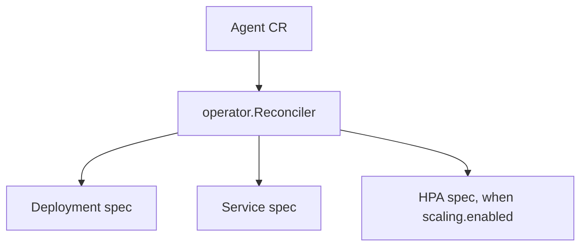

# Guide: Deploy on Kubernetes

**Time:** ~30 minutes
**You will deploy:** the Beluga CRDs, an `Agent` custom resource, and the Deployment, Service and HPA that the operator package computes for it.
**Prerequisites:** Kubernetes cluster (kind, minikube, or real), `kubectl`, a clone of this repository, [Deploy on Docker guide](./deploy-docker.md).

> **Status.** `k8s/` is an optional overlay and is partly built. What exists today:
>
> - CRDs in [`k8s/crds/`](../../k8s/crds/): `Agent`, `Team`, `ModelConfig`, `ToolServer`, `MemoryStore`, `GuardPolicy` (group `beluga.ai`, version `v1alpha1`).
> - [`k8s/operator`](../../k8s/operator/): Go types for the CRDs and a `Reconciler` (`operator.NewDefaultReconciler()`) that computes the desired Deployment, Service and optional HPA as plain structs. It has no Kubernetes client dependency.
> - [`k8s/webhooks`](../../k8s/webhooks/): admission webhook handlers.
> - A Helm chart in [`k8s/helm/`](../../k8s/helm/) for an operator Deployment.
>
> What does not exist yet: a controller binary that watches the cluster and applies the reconciler's output, and a published `ghcr.io/lookatitude/beluga-operator` image (the Helm chart's default). NetworkPolicy and ServiceMonitor generation are not implemented. Until then, run the reconciler from your own controller, or render its output and apply it yourself.

## What gets computed



## Step 1 — install the CRDs

```bash
kubectl apply -f k8s/crds/
kubectl get crd agents.beluga.ai
```

## Step 2 — secrets

```bash
kubectl create secret generic openai --from-literal=api-key=$OPENAI_API_KEY
```

## Step 3 — the Agent CR

The fields below are the ones in `operator.AgentSpec` and the `agents.beluga.ai` CRD.

```yaml
# research-assistant.yaml
apiVersion: beluga.ai/v1alpha1
kind: Agent
metadata:
  name: research-assistant
spec:
  image: myorg/beluga-agent:v2.1.0
  port: 8080
  replicas: 3

  persona:
    role: research assistant
    goal: answer research questions with citations
  planner: react
  maxIterations: 10

  modelRef: openai-gpt4o
  modelConfig:
    provider: openai
    model: gpt-4o
    apiKeyRef: openai/api-key   # <secret-name>/<key>

  toolRefs: []

  resources:
    requests:
      cpu: 500m
      memory: 1Gi
    limits:
      cpu: "2"
      memory: 4Gi

  scaling:
    enabled: true
    minReplicas: 2
    maxReplicas: 10
    targetCPUUtilization: 75
```

```bash
kubectl apply -f research-assistant.yaml
kubectl get agents
```

Applying the CR stores it in the cluster. Nothing reconciles it until a controller runs (see the status note).

## Step 4 — compute the resources

From Go, in your controller or a small tool:

```go
r := operator.NewDefaultReconciler()
result, err := r.ReconcileAgent(ctx, &agentResource) // an *operator.AgentResource decoded from the CR
if err != nil {
	return err // invalid spec, e.g. missing modelRef
}
// result.Deployment, result.Service and (when scaling is enabled) result.HPA
// describe the desired objects. Map them onto your Kubernetes client's types
// and apply them.
```

The container itself is the binary from the [Docker guide](./deploy-docker.md): it serves `POST /api/chat` and the Agent Card at `/.well-known/agent.json` on `spec.port`.

## Step 5 — verify

Once the Deployment and Service exist:

```bash
kubectl port-forward svc/research-assistant 8080:8080 &
curl -N http://localhost:8080/api/chat \
  -H 'Content-Type: application/json' \
  -d '{"session_id":"demo","message":"hello"}'
curl http://localhost:8080/.well-known/agent.json | jq
```

## Scaling

With `scaling.enabled: true` the reconciler emits an HPA between `minReplicas` and `maxReplicas` on CPU utilisation. For custom metrics (e.g. queue depth), patch the HPA's `spec.metrics` yourself.

## Network policy

Not generated yet. Write a default-deny egress `NetworkPolicy` for the agent pods that allows only your LLM provider and backing services, and combine it with an egress gateway (Istio, Cilium) for hostname-level enforcement.

## Upgrades

Update `spec.image` and re-apply the Deployment. Sessions in the Runner's default in-memory session service do not survive a pod restart; implement `runtime.SessionService` over a shared store if they must.

## Common mistakes

- **Forgetting the NetworkPolicy.** Compromised agent + no egress policy = data exfiltration.
- **Leaving secrets in the CR spec.** Reference a Secret (`modelConfig.apiKeyRef`); never embed keys in the Agent spec.
- **Under-sizing resources.** LLM calls are memory-heavy when streaming. Start at 1Gi requests.
- **No graceful shutdown time.** Set `terminationGracePeriodSeconds: 60` on the pod spec so the runner can drain.
- **Expecting the CR to deploy itself.** Without a running controller, `kubectl apply` of an `Agent` only stores it. See the status note.

## Related

- [17 — Deployment Modes](../architecture/17-deployment-modes.md)
- [08 — Runner and Lifecycle](../architecture/08-runner-and-lifecycle.md) — graceful shutdown.
- [13 — Security Model](../architecture/13-security-model.md) — NetworkPolicy + guards.
- [Deploy on Docker](./deploy-docker.md) — simpler alternative.
