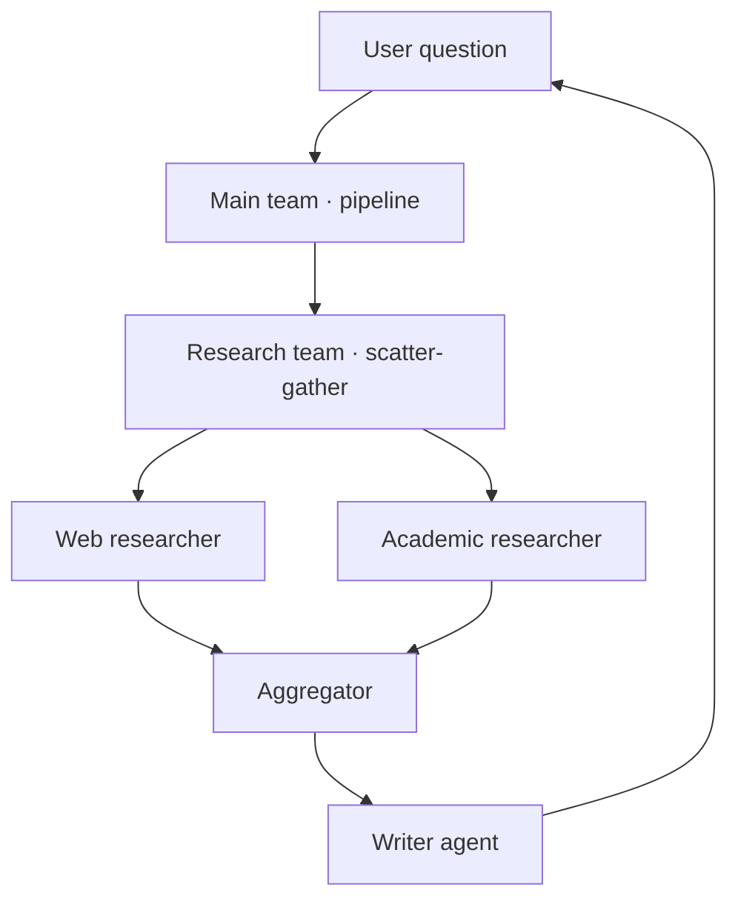

# Guide: Build a Multi-Agent Team

**Time:** ~20 minutes
**You will build:** a research team with two parallel researchers, an aggregator, and a writer.
**Prerequisites:** [First Agent guide](./first-agent.md), [Orchestration Patterns](../architecture/07-orchestration-patterns.md).

## What you'll build



Teams come from `runtime.NewTeam`. A `runtime.Team` implements `agent.Agent`, so a team can be a member of another team.

## Step 1 — build the individual agents

Beluga has no built-in web or arXiv search tools. This guide defines two stub tools with `tool.NewFuncTool`; swap their bodies for a real search API or an MCP server (`tool.FromMCP`).

```go
// main.go
package main

import (
	"context"
	"fmt"
	"log"
	"os"

	"github.com/lookatitude/beluga-ai/v2/agent"
	"github.com/lookatitude/beluga-ai/v2/config"
	"github.com/lookatitude/beluga-ai/v2/llm"
	"github.com/lookatitude/beluga-ai/v2/protocol/rest"
	"github.com/lookatitude/beluga-ai/v2/runtime"
	"github.com/lookatitude/beluga-ai/v2/tool"

	_ "github.com/lookatitude/beluga-ai/v2/llm/providers/openai"
)

// SearchInput is the typed input for both search tools.
type SearchInput struct {
	Query string `json:"query" description:"Search query" required:"true"`
}

func searchTool(name, description string) tool.Tool {
	return tool.NewFuncTool(name, description,
		func(ctx context.Context, in SearchInput) (*tool.Result, error) {
			// Replace with a real search call.
			return tool.TextResult(fmt.Sprintf("no results for %q (stub)", in.Query)), nil
		})
}

func main() {
	ctx := context.Background()
	model, err := llm.New("openai", config.ProviderConfig{
		Provider: "openai",
		APIKey:   os.Getenv("OPENAI_API_KEY"),
		Model:    "gpt-4o",
	})
	if err != nil {
		log.Fatal(err)
	}

	webSearcher := agent.New("web-researcher",
		agent.WithPersona(agent.Persona{
			Role:      "Web researcher",
			Goal:      "Find recent web articles on a topic and summarise key findings",
			Backstory: "You favour primary sources and flag uncertainty explicitly",
		}),
		agent.WithLLM(model),
		agent.WithTools([]tool.Tool{searchTool("web_search", "Search the web")}),
	)

	academicSearcher := agent.New("academic-researcher",
		agent.WithPersona(agent.Persona{
			Role:      "Academic researcher",
			Goal:      "Find relevant peer-reviewed papers and extract their conclusions",
			Backstory: "You cite papers precisely and distinguish claim from evidence",
		}),
		agent.WithLLM(model),
		agent.WithTools([]tool.Tool{searchTool("arxiv_search", "Search arXiv papers")}),
	)

	aggregator := agent.New("aggregator",
		agent.WithPersona(agent.Persona{
			Role: "Research aggregator",
			Goal: "Combine web and academic findings into a single structured brief",
		}),
		agent.WithLLM(model),
	)

	writer := agent.New("writer",
		agent.WithPersona(agent.Persona{
			Role: "Technical writer",
			Goal: "Produce a 500-word summary in the user's voice",
		}),
		agent.WithLLM(model),
	)

	// Step 2: compose the research team (scatter-gather).
	researchTeam := runtime.NewTeam(
		runtime.WithTeamID("research-team"),
		runtime.WithTeamPersona(agent.Persona{Role: "Research team"}),
		runtime.WithAgents(webSearcher, academicSearcher),
		runtime.WithPattern(runtime.ScatterGatherPattern(aggregator)),
	)

	// Step 3: compose the top-level team (pipeline: research, then write).
	mainTeam := runtime.NewTeam(
		runtime.WithTeamID("main"),
		runtime.WithAgents(researchTeam, writer),
		runtime.WithPattern(runtime.PipelinePattern()),
	)

	// Step 4: serve the team over HTTP.
	srv := rest.NewServer()
	if err := srv.RegisterAgent("chat", mainTeam); err != nil {
		log.Fatal(err)
	}
	if err := srv.Serve(ctx, ":8080"); err != nil {
		log.Fatal(err)
	}
}
```

## Step 2 — the research team (scatter-gather)

`runtime.ScatterGatherPattern(aggregator)` invokes every member in parallel, combines their outputs, and streams the aggregator's answer. `researchTeam` is itself an `agent.Agent`.

## Step 3 — the top-level team (pipeline)

`runtime.PipelinePattern()` runs members in order and feeds each member's text output to the next. `researchTeam` appears as a regular member of `mainTeam`; the pipeline doesn't know it's a sub-team. This is recursive composition ([DOC-07](../architecture/07-orchestration-patterns.md)).

Two supervisor-style alternatives exist:

- `runtime.SupervisorPattern(coordinator)` streams a coordinator agent whose prompt lists the members' IDs and roles. The coordinator only delegates if you give it a way to (for example handoffs via `agent.WithHandoffs`).
- `orchestration.NewSupervisor(strategy, agents...)` picks a member per round with a `StrategyFunc` such as `orchestration.DelegateBySkill()` or `orchestration.RoundRobin()`. It is a `core.Runnable`, not an `agent.Agent`.

## Step 4 — serve the team

`rest.NewServer()` exposes each registered agent at `POST /{path}/invoke` (JSON) and `POST /{path}/stream` (SSE). Wrap the team in a `runtime.NewRunner` instead when you need sessions, plugins or a worker pool; the Runner does not serve HTTP itself.

## Step 5 — test it

```bash
curl -N http://localhost:8080/chat/stream \
  -H 'Content-Type: application/json' \
  -d '{"input":"What are the latest advances in retrieval-augmented generation?"}'
```

Expected flow:
1. `mainTeam` passes the question to `researchTeam`.
2. `researchTeam` invokes `webSearcher` and `academicSearcher` in parallel.
3. The aggregator combines their outputs into a structured brief.
4. `mainTeam` passes the brief to `writer`.
5. The writer produces the 500-word summary, which streams to the client as SSE events.

## Refactoring to deeper composition

Later, you decide the web researcher itself needs a sub-team (a researcher plus a fact-checker). Replace the `webSearcher` agent with a team:

```go
webSearcher := runtime.NewTeam(
	runtime.WithTeamID("web-team"),
	runtime.WithAgents(rawWebSearcher, factChecker),
	runtime.WithPattern(runtime.PipelinePattern()),
)
```

`researchTeam` is unchanged. It doesn't care that `webSearcher` went from a single agent to a sub-team, because both are `agent.Agent`.

## Common mistakes

- **Forgetting the aggregator on scatter-gather.** Without one, you get N parallel responses and no combination. The aggregator is the reducer.
- **Not propagating context.** Make sure session, tenant and trace context flows to every sub-agent. `runtime.Team` passes its `ctx` to every member; custom composition must do the same.
- **Tight coupling between team members.** Members communicate through the pattern, not by directly importing each other's types.
- **Using scatter-gather when you needed a pipeline.** If the agents depend on each other's outputs, you want Pipeline, not Scatter-Gather.

## Related

- [07 — Orchestration Patterns](../architecture/07-orchestration-patterns.md) — the orchestration patterns with trade-offs.
- [05 — Agent Anatomy](../architecture/05-agent-anatomy.md#teams-are-agents-recursive-composition) — why this recursion works.
- [08 — Runner and Lifecycle](../architecture/08-runner-and-lifecycle.md) — the Runner hosting the team.
